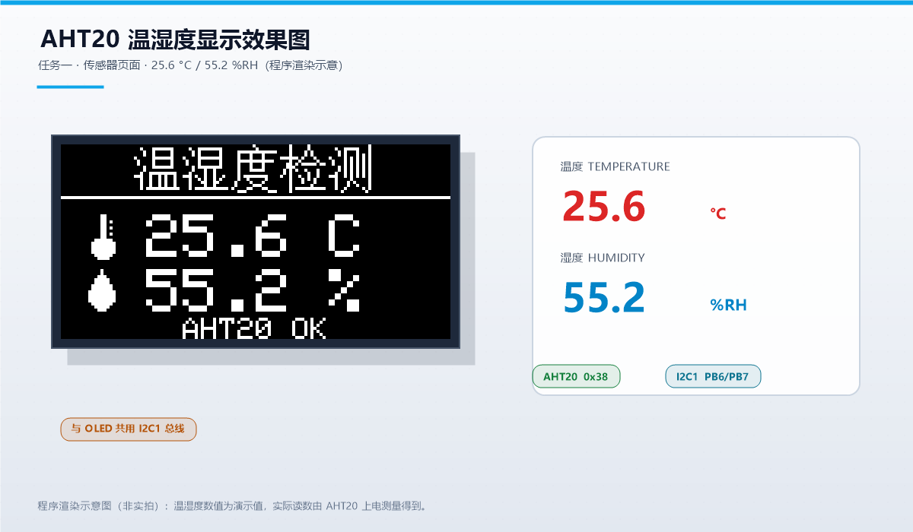
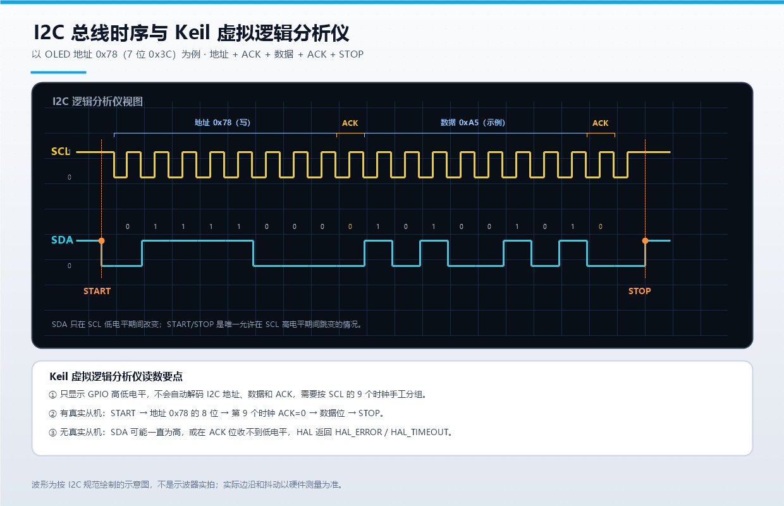

# STM32F103C8T6 OLED 显示与 AHT20 温湿度采集综合实验报告

| 项目 | 内容 |
|---|---|
| 课程 | 嵌入式系统原理与应用 |
| 姓名 | 徐正昕 |
| 学号 | 632407030612 |
| 班级 | 通信 2403（EIE 2403） |
| 实验室 | 重庆交通大学物联网 205 实训室 |
| 实验日期 | 2026 年 10 月 |
| 主控芯片 | STM32F103C8T6 |
| 显示模块 | 0.96 英寸 SSD1306 OLED（128×64，I2C） |
| 传感器 | AHT20 温湿度传感器（I2C） |

## 摘要

本实验以 STM32F103C8T6 最小系统板为核心，在同一套 STM32F1xx HAL 工程中完成两个任务。任务一从零实现 SSD1306 OLED 的 I2C 驱动，建立 1 KB 显存，支持像素、直线、矩形、圆、5×7 ASCII、16×16 汉字和位图绘制；在此基础上显示学生信息、读取 AHT20 温湿度，并分别用软件滚动和 SSD1306 硬件滚动实现长文本与静态图案的滚动显示。任务三使用 CubeMX 风格的 HAL 工程，将 U8g2 裁剪并移植到 STM32F103 与 SSD1306 平台，完成 U8g2 图形/字体 demo、学号姓名页、四向滚动页和双帧动画头像页。两个工程均使用 Keil MDK 5 + ARMCC 5.06 编译，结果均为 0 error / 0 warning。报告最后结合 I2C 时序图，回答 Keil 虚拟逻辑分析仪中 SDA 波形的表现，并给出无法真实抓取 I2C 信号时的替代方案。

**关键词**：STM32F103C8T6；SSD1306；AHT20；U8g2；I2C；OLED

---

## 一、实验目的

1. 掌握 STM32F103 的 GPIO、I2C、USART 初始化方法，理解 HAL 库的基本使用流程。
2. 理解 SSD1306 OLED 的显存组织、页地址模式和 I2C 写命令/写数据时序，能够从零编写显示驱动。
3. 掌握 16×16 汉字点阵的生成、存储和检索方法，实现中英文混排。
4. 掌握 AHT20 的初始化、触发测量、数据读取和 CRC8 校验方法。
5. 理解软件滚动与 SSD1306 硬件滚动的区别，能够根据场景选择合适方案。
6. 掌握 U8g2 的裁剪和移植方法，能够把第三方图形库接入 STM32 HAL。
7. 能够使用 Keil 虚拟逻辑分析仪观察 I2C 引脚波形，并分析无真实从机时的现象。
8. 培养查阅数据手册、定位通信故障和撰写实验报告的能力。

---

## 二、实验环境

### 2.1 硬件环境

| 器件 | 型号/参数 | 作用 |
|---|---|---|
| 主控板 | STM32F103C8T6 最小系统板 | 72 MHz Cortex-M3，64 KB Flash，20 KB RAM |
| 显示屏 | 0.96 英寸 SSD1306，128×64，I2C | 显示文字、图形和动画 |
| 传感器 | AHT20，I2C 地址 0x38 | 采集温度和相对湿度 |
| 调试器 | ST-Link V2 | 下载与在线调试 |
| 串口工具 | USB-TTL + 串口助手 | 查看调试输出，115200-8-N-1 |
| 按键 | PA0 外接按键 | 手动切换页面 |
| LED | PC13 板载 LED | 500 ms 心跳指示 |

### 2.2 软件环境

| 软件 | 版本/说明 |
|---|---|
| Keil MDK | 5.x，ARMCC 5.06 |
| STM32CubeMX | 用于生成参考初始化代码（`OLED_AHT20.ioc`） |
| STM32F1xx HAL | ST 官方 HAL 库 |
| U8g2 | 裁剪版，保留 SSD1306 128×64 I2C 全缓冲驱动 |
| 串口助手 | 115200-8-N-1，用于查看运行日志 |
| 字库脚本 | PowerShell + GDI+，生成 16×16 汉字和 5×7 ASCII |

### 2.3 硬件接线

| 信号 | STM32F103C8T6 | OLED | AHT20 | 说明 |
|---|---|---|---|---|
| 电源 | 3.3 V | VCC | VCC | 严禁接 5 V |
| 地 | GND | GND | GND | 必须共地 |
| 时钟 | PB6 | SCL | SCL | I2C1_SCL，400 kHz |
| 数据 | PB7 | SDA | SDA | I2C1_SDA，400 kHz |
| 串口发送 | PA9 | — | — | USART1_TX，接 USB-TTL 的 RX |
| 串口接收 | PA10 | — | — | USART1_RX，接 USB-TTL 的 TX |
| 按键 | PA0 | — | — | 内部上拉，按下接地 |
| LED | PC13 | — | — | 低电平点亮 |

OLED 的 7 位地址为 0x3C，HAL 使用 8 位写地址 0x78；AHT20 的 7 位地址为 0x38，8 位写地址为 0x70。两个器件挂在同一条 I2C1 总线上，靠地址区分。

---

## 三、总体设计

### 3.1 系统结构

系统按“硬件层—驱动层—应用层”划分：

```
+--------------------------------------------------+
|                   应用层                          |
|  Task1: 信息页 / 温湿度页 / 软件滚动 / 硬件滚动    |
|  Task3: U8g2 demo / 信息页 / 四向滚动 / 头像 / 温湿度 |
+--------------------------------------------------+
|                   驱动层                          |
|  oled_ssd1306.c   font_cn.c   font5x7.c           |
|  aht20.c          avatar.c    u8g2 (裁剪版)        |
+--------------------------------------------------+
|                   硬件抽象层                      |
|  STM32F1xx HAL: GPIO / I2C1 / USART1 / TIM(base)  |
+--------------------------------------------------+
|                   硬件层                          |
|  STM32F103C8T6 + SSD1306 OLED + AHT20 + 按键/LED  |
+--------------------------------------------------+
```

### 3.2 两个单目标工程

任务一和任务三共用同一套 HAL、CMSIS、启动文件和板级代码，但应用入口不同。最初尝试在同一个 Keil 工程中建立两个 Target，但 uVision 在 Build 时会把两个 Target 的源文件合并到同一次编译中，导致 `task1_app.c` 和 `task3_app.c` 同时被编译，既浪费空间又容易产生重复符号。最终改为两个独立的单目标工程：

| 工程 | 预处理宏 | 应用文件 | 输出目录 |
|---|---|---|---|
| `Task1_SSD1306.uvprojx` | `USE_HAL_DRIVER, STM32F103xB` | `task1_app.c` | `Objects_Task1/` |
| `Task3_U8g2.uvprojx` | `USE_HAL_DRIVER, STM32F103xB, TASK3_BUILD` | `task3_app.c` | `Objects_Task3/` |

`main.c` 通过 `#if defined(TASK3_BUILD)` 选择调用 `Task3_Run()` 或 `Task1_Run()`，两个工程各自只编译自己的应用文件，互不干扰。

### 3.3 时钟与外设配置

- 系统时钟：HSE 8 MHz 经 PLL ×9 得到 72 MHz；APB1 为 36 MHz，APB2 为 72 MHz，Flash 等待周期 2。
- I2C1：400 kHz，7 位地址，占空比 2，关闭双地址、通用呼叫和时钟延展。
- USART1：115200-8-N-1，仅用于调试输出。
- GPIO：PC13 推挽输出（默认高，LED 灭），PA0 上拉输入。
- 时基：SysTick 提供 1 ms 节拍，页面调度和动画均基于 `HAL_GetTick()`。

---

## 四、任务一：自定义 SSD1306 驱动与综合显示

### 4.1 SSD1306 显存组织

SSD1306 的 128×64 显存按 8 页组织，每页 8 行像素，每列 1 字节，字节的 bit0 对应页内最上面的像素。驱动定义：

```c
#define OLED_WIDTH       128U
#define OLED_HEIGHT      64U
#define OLED_PAGES       8U
#define OLED_BUF_SIZE    (OLED_WIDTH * OLED_PAGES)   /* 1024 字节 */

static uint8_t s_gram[OLED_BUF_SIZE];
```

所有绘图函数先写 `s_gram`，最后调用 `OLED_Display()` 一次性刷新。刷新时先发送页地址和列地址，再连续写入 128 字节，避免每个像素都发起一次 I2C 传输。

像素写入的核心是：

```c
s_gram[(y >> 3) * OLED_WIDTH + x] |= (uint8_t)(1U << (y & 7));
```

`y >> 3` 得到页号，`y & 7` 得到页内行号。清除像素时对该位取反即可。直线、矩形、圆、位图都建立在这一函数之上。

### 4.2 初始化序列

`OLED_Init()` 先调用 `HAL_I2C_IsDeviceReady()` 探测 0x78，确认器件存在后发送初始化命令：

| 命令 | 作用 |
|---|---|
| `0xAE` | 关闭显示 |
| `0xD5 0x80` | 设置时钟分频 |
| `0xA8 0x3F` | 设置复用率为 1/64 |
| `0xD3 0x00` | 显示偏移为 0 |
| `0x40` | 起始行为 0 |
| `0x8D 0x14` | 开启电荷泵 |
| `0x20 0x00` | 水平寻址模式 |
| `0xA1` | 段重映射，左右方向正确 |
| `0xC8` | COM 扫描方向，上下方向正确 |
| `0xDA 0x12` | COM 引脚配置 |
| `0x81 0xCF` | 对比度 |
| `0xD9 0xF1` | 预充电周期 |
| `0xDB 0x40` | VCOMH 电压 |
| `0xA4` | 显示显存内容 |
| `0xA6` | 正常显示（非反色） |
| `0x2E` | 停止滚动 |
| `0xAF` | 开启显示 |

写命令时先发控制字节 `0x00`，再发命令；写数据时先发 `0x40`。这是 SSD1306 I2C 协议的关键区别。

### 4.3 16×16 汉字与 5×7 ASCII

汉字点阵使用 Windows 宋体 16 px 通过 GDI+ 渲染生成。每个汉字 16×16 像素，按行优先、每行 2 字节、MSB 在左存储，共 32 字节。字库以“Unicode 码点 → 点阵指针”的方式组织，`FontCN_Get()` 负责查找。

界面文字不直接写中文字符串，而是写成 `uint16_t` 码点数组，例如：

```c
static const uint16_t TXT_NAME[] =
{
    0x5F90, 0x6B63, 0x6615, 0   /* 徐正昕 */
};
```

这样做的好处是：无论 Keil 编辑器把源文件保存成 GB2312 还是 UTF-8，编译器看到的都是明确的 16 位码点，不会出现“中文变乱码”或“一个汉字被拆成多个字节”的问题。

ASCII 使用 Adafruit GFX 兼容的 5×7 字库。在 16 px 行内绘制时，把 5×7 字形放在第 5~11 行，与 16×16 汉字垂直居中对齐，因此中英文混排时视觉基线一致。

### 4.4 AHT20 驱动

AHT20 的测量流程如下：

1. 上电等待 40 ms。
2. 读状态字节，若 bit3（校准使能位）为 0，发送初始化命令 `0xBE 0x08 0x00`，等待 10 ms。
3. 发送触发命令 `0xAC 0x33 0x00`，等待 80 ms。
4. 连续读取 7 字节：状态、湿度 20 bit、温度 20 bit、CRC8。
5. 若状态字节 bit7（忙标志）为 1，等待 20 ms 后重试，最多 3 次。

数据换算：

```
raw_h = ((buf[1] << 16) | (buf[2] << 8) | buf[3]) >> 4
H = raw_h * 100 / 2^20

raw_t = ((buf[3] & 0x0F) << 16) | (buf[4] << 8) | buf[5]
T = raw_t * 200 / 2^20 - 50
```

CRC8 使用多项式 0x31、初值 0xFF，对前 6 字节计算并与第 7 字节比较。考虑到不同批次模块的 CRC 实现可能存在差异，程序在 CRC 失败时只累计错误计数，仍然使用本次数据；如果通信本身失败，则显示 `AHT20 ERR`。

### 4.5 页面设计

任务一共四个页面，按 6 s、6 s、12 s、8 s 自动轮播，按 PA0 可立即切换：

1. **学生信息页**：顶部标题“学生信息”，下面是姓名“徐正昕”、学号“632407030612”、班级“通信2403”，底部有分隔线。
2. **温湿度页**：温度计和水滴图标，温度、湿度用 2 倍放大的 5×7 字体显示，底部显示 `AHT20 OK` 或 `AHT20 ERR`，每 500 ms 更新一次。
3. **长文本软件滚动页**：标题“长文本滚动”，正文为 `Hello，欢迎来到重庆交通大学物联网205实训室！`，从右向左循环。
4. **硬件滚动页**：页 0 固定标题 `HARDWARE SCROLL`，页 1~6 为静态字符图案，页 7 固定底部说明；前 4 秒水平左滚，后 4 秒切换为左 + 垂直对角线滚动。

### 4.6 软件滚动

软件滚动的本质是“每帧改变绘制起点 x，然后整屏重绘”。文本宽度由 `OLED_TextWidthU16()` 计算：ASCII 占 6 px，汉字占 16 px。本项目长文本共 336 px，屏幕宽 128 px，总行程为 464 px。

```c
uint32_t pos = (elapsed * 55U) / 1000U;   /* 55 像素/秒 */
int16_t x = (int16_t)((int32_t)OLED_WIDTH - (int32_t)pos);
OLED_DrawTextU16(x, 24, TXT_LONG_SCROLL, OLED_TEXT_MIXED16, 1);
```

驱动在 `OLED_DrawPixel()` 中自动裁剪超出屏幕的像素，因此不需要额外计算可见区间。每帧间隔 25 ms，实际刷新率约 40 帧/秒，滚动比较平滑。

### 4.7 SSD1306 硬件滚动

SSD1306 内部有滚动引擎，写入命令后由芯片自动移动显示内容，MCU 不需要反复重绘。相关命令：

| 命令 | 含义 |
|---|---|
| `0x26` | 水平向右滚动 |
| `0x27` | 水平向左滚动 |
| `0x29` | 垂直 + 向右滚动 |
| `0x2A` | 垂直 + 向左滚动 |
| `0x2F` | 启动滚动 |
| `0x2E` | 停止滚动 |

滚动参数包括：虚拟页数（通常 0）、起始页、滚动间隔、结束页、垂直偏移。本项目设置页 1~6 参与滚动，页 0 和页 7 固定，因此标题和底部说明保持不动；`interval=0` 表示最快滚动速度。

硬件滚动的限制是：它只能滚动显存中已有的静态内容，不能直接滚动任意长度的新文本。因此长文本页采用软件滚动，硬件滚动页只用于演示静态图案的水平和对角线移动。

### 4.8 温湿度页效果图



图 4-1 由 `tools/gen_report_images.ps1` 按程序实际使用的字库、图标和坐标渲染，用于说明页面布局。**该图不是硬件实拍**，实际 OLED 为单色发光，亮度和对比度以实物为准；真实硬件照片由作者在实验台上补拍。

---

## 五、任务三：CubeMX HAL + 裁剪 U8g2 移植

### 5.1 CubeMX 配置

`OLED_AHT20.ioc` 保存了参考配置：HSE 8 MHz、PLL ×9、72 MHz 主频、I2C1 400 kHz、USART1 115200、PC13 输出、PA0 上拉输入。实际工程直接使用 CubeMX 生成的 HAL 初始化风格代码，但应用层代码是手工编写的，避免每次 Generate Code 覆盖业务逻辑。

### 5.2 U8g2 裁剪

完整 U8g2 包含大量显示驱动和数百种字体，直接加入 Keil 工程会显著增加编译时间和 Flash 占用。本项目只保留实际使用的模块：

| 类别 | 保留文件 |
|---|---|
| 公共头文件 | `u8g2.h`、`u8x8.h` |
| U8g2 核心 | `u8g2_setup.c`、`u8g2_buffer.c`、`u8g2_hvline.c`、`u8g2_ll_hvline.c`、`u8g2_intersection.c` |
| 图形函数 | `u8g2_box.c`、`u8g2_line.c`、`u8g2_circle.c`、`u8g2_arc.c`、`u8g2_polygon.c` |
| 位图/字体 | `u8g2_bitmap.c`、`u8g2_font.c`、`u8g2_kerning.c`、`u8g2_cleardisplay.c` |
| 显示设备 | `u8g2_d_setup_min.c`、`u8g2_d_memory_min.c`、`u8x8_d_ssd1306_128x64_noname.c` |
| 底层通信 | `u8x8_setup.c`、`u8x8_byte.c`、`u8x8_cad.c`、`u8x8_display.c`、`u8x8_gpio.c`、`u8x8_capture.c` |
| 字符串工具 | `u8x8_string.c`、`u8x8_u8toa.c`、`u8x8_u16toa.c`、`u8x8_8x8.c` |
| 字体数据 | `u8g2_fonts_min.c`（5×7、6×10、6×12、7×14B、ncenB10、ncenB14） |

裁剪原则：

1. 只保留 SSD1306 128×64 I2C 一种显示驱动，删除 SH1106、ST7565、UC1608 等驱动。
2. 只保留全缓冲接口 `u8g2_Setup_ssd1306_i2c_128x64_noname_f`，删除 1/2 页缓冲接口。
3. 只保留 demo 和界面用到的 6 种字体，删除其余字体。
4. 删除 `mui`、`u8log`、`u8g2_message`、`u8g2_selection_list` 等无关模块。
5. 不使用 U8g2 自带的软件 I2C，改用 STM32 HAL 的硬件 I2C。

最终保留 30 个源文件，完整清单见 `Drivers/U8g2/README.md`。

### 5.3 移植层：U8x8 字节回调

U8g2 通过 `u8x8` 的字节回调与底层通信。核心回调如下：

```c
static uint8_t U8g2_ByteCb(u8x8_t *u8x8, uint8_t msg, uint8_t arg_int, void *arg_ptr)
{
    switch (msg)
    {
        case U8X8_MSG_BYTE_INIT:
            return 1;
        case U8X8_MSG_BYTE_START_TRANSFER:
            s_tx_len = 0;
            return 1;
        case U8X8_MSG_BYTE_SEND:
            /* 把 arg_int 个字节追加到 s_tx_buf */
            return 1;
        case U8X8_MSG_BYTE_END_TRANSFER:
            HAL_I2C_Master_Transmit(&hi2c1, OLED_I2C_ADDR, s_tx_buf, s_tx_len, 100);
            return 1;
        default:
            return 0;
    }
}
```

显示初始化：

```c
u8g2_Setup_ssd1306_i2c_128x64_noname_f(&s_u8g2, U8G2_R0,
                                       U8g2_ByteCb, U8g2_GpioDelayCb);
u8g2_InitDisplay(&s_u8g2);
u8g2_SetPowerSave(&s_u8g2, 0);
```

全缓冲模式下，U8g2 在 RAM 中维护 1 KB 缓冲区，`u8g2_SendBuffer()` 时把整屏数据交给回调，再由 HAL 一次发送。这样比逐像素发送快得多，也能保证画面不闪烁。

### 5.4 U8g2 demo 页

demo 页展示 U8g2 的常用绘图和字体能力：

- 左上角 `U8g2 Demo` 使用 7×14 粗体；
- 左侧 60×40 矩形框内画圆、半径线和圆点，指针按 140 ms 一步做圆周运动；
- 右侧进度条按 80 ms 一步往复；
- 右侧用 `ncenB14` 显示 `U8g2`，用 5×7 显示 `STM32F103`、`SSD1306`；
- 底部显示 `128x64`。

该页用于验证 U8g2 的图形函数、字体渲染、缓冲区刷新和 I2C 回调都工作正常。

### 5.5 学号姓名页

标题 `U8g2 PORT` 用 7×14 粗体居中，下面依次是：

- 姓名“徐正昕”（16×16 汉字，x=40，y=20）；
- 学号 `632407030612`（6×12 字体，x=28，y=45）；
- 班级“通信2403”（16×16 汉字，x=36，y=48）。

由于 U8g2 本身不带中文字库，汉字通过 `u8g2_DrawXBMP()` 绘制，ASCII 则由 U8g2 字体绘制。两者混排时统一按 16 px 行高计算宽度：ASCII 6 px，汉字 16 px。

### 5.6 四向滚动

四向滚动页用 12 秒循环四个方向，每个方向 3 秒：

| 阶段 | 方向 | 实现 |
|---|---|---|
| 0 | 右 → 左 | 文本起点 `x = 128 - 70t`，水平移动 |
| 1 | 左 → 右 | 文本起点 `x = -text_w + 70t`，水平移动 |
| 2 | 下 → 上 | 六个汉字竖向排列，整体 `y = 64 - 60t` |
| 3 | 上 → 下 | 六个汉字竖向排列，整体 `y = -108 + 60t` |

水平速度为 70 px/s，垂直速度为 60 px/s。滚动区域用 `u8g2_SetClipWindow(&s_u8g2, 0, 11, 128, 55)` 限制在 y=11~54，标题（y=10 以上）和底部方向标签（y=62）不会被滚动文字覆盖。

由于 U8g2 的 `DrawXBMP` 不会自动处理负坐标，代码实现了 `T3_DrawCellClip()`：当字符部分移出视口时，先复制点阵、按 `skip_x`/`skip_y` 平移，再只绘制可见部分。这样竖向滚动时不会出现花屏或越界。

### 5.7 动画头像

头像为 56×56 像素、两帧 XBMP 点阵，位于屏幕左侧 (2, 7)；右侧显示“头像”“徐正昕”“通信2403”，顶部显示学号。

动画节奏：

- 每 2 秒一个周期；
- 前 1.55 秒显示睁眼帧，后 0.45 秒显示眨眼帧；
- 刷新间隔 80 ms，即约 12.5 帧/秒；
- 两帧之间只有眼睛区域不同，既简单又能看出明显动画效果。

头像点阵由 `tools/gen_avatar.ps1` 生成，采用与 U8g2 XBMP 一致的行优先、MSB 在左格式。温度计和水滴图标也由同一脚本手工构造，保证 16×16 下轮廓清晰。

### 5.8 AHT20 温湿度页

任务三的温湿度页与任务一共用 `aht20.c`，但显示改用 U8g2：

- 标题“温湿度检测”用 16×16 汉字；
- 温度计、水滴图标用 `u8g2_DrawXBMP()`；
- 温度和湿度用 7×14 粗体；
- 底部状态 `AHT20 OK` / `AHT20 ERR` 用 5×7 居中；
- 每 500 ms 读一次传感器，每 2 秒通过 USART1 打印一次 `T=xx.x C H=xx.x %`。

---

## 六、Keil 虚拟逻辑分析仪与 I2C 波形分析

### 6.1 虚拟逻辑分析仪能看到什么

Keil uVision 的 Logic Analyzer（`View → Analysis Windows → Logic Analyzer`）用于观察仿真环境中变量或引脚的电平变化。它可以显示数字信号的 0/1 波形、测量脉宽和周期，但它**不是协议分析仪**：

- 它只显示高低电平，不会自动标注“START”“地址 0x78”“ACK”“数据 0xA5”；
- 需要手动按 SCL 的 9 个时钟周期分组，才能读出地址和数据；
- 在纯软件仿真、没有真实 OLED/AHT20 从机模型时，STM32 的 I2C 外设收不到 ACK，波形可能不完整或停在某一步；
- 在真实硬件调试时，普通调试器通常不能直接抓取物理引脚，需要硬件逻辑分析仪或示波器。

因此，虚拟逻辑分析仪适合验证“MCU 是否在正确的时间输出正确的电平”，不适合单独证明“从机已经正确响应”。

### 6.2 正常 I2C 写时序

以 OLED 写地址 0x78 为例，一次“地址 + 数据 + 停止”的完整时序如下：

1. **空闲**：SCL 和 SDA 都为高电平。
2. **START**：SCL 为高时，SDA 由高变低。
3. **地址 0x78**：8 个时钟，MSB 在前，即 `0111 1000`。每个 bit 在 SCL 低电平期间改变，在 SCL 高电平期间被采样。
4. **ACK**：第 9 个时钟，从机把 SDA 拉低，表示应答。
5. **数据 0xA5**：8 个时钟，`1010 0101`，同样是 MSB 在前。
6. **ACK**：第 9 个时钟，从机再次拉低 SDA。
7. **STOP**：SCL 为高时，SDA 由低变高。



图 6-1 为按 I2C 规范绘制的示意图，包含 START、地址 0x78、ACK、数据 0xA5、ACK 和 STOP。实际波形会有上升沿、下降沿和抖动，边沿时间由总线上拉电阻和电容决定，不能像示意图这样垂直。

### 6.3 无真实从机时 SDA 会显示什么

这是本实验最容易被问到的现象。需要分两种情况：

**情况一：纯 Keil 软件仿真，总线上没有从机模型。**

- SDA 在空闲时通常保持高电平；
- 启动传输后，MCU 会输出 START 和地址位；
- 到第 9 个 ACK 时钟时，没有从机把 SDA 拉低，SDA 保持高电平，即 NACK；
- HAL 可能返回 `HAL_ERROR` 或 `HAL_TIMEOUT`，I2C 状态机可能停在 BUSY；
- 之后的 SCL 可能不再继续输出，SDA 保持高电平，直到软件复位 I2C 外设；
- 因此逻辑分析仪上看到的是“START + 地址 + NACK + 停止/挂起”，而不是完整的地址 + ACK + 数据 + ACK。

**情况二：真实硬件，但从机未接、地址错误或从机损坏。**

- 如果 SDA/SCL 有上拉，空闲时都为高；
- MCU 发送地址后收不到 ACK，HAL 返回错误；
- 如果 SDA 被短路到地，可能一直为低，甚至导致总线锁死；
- 如果从机把 SDA 一直拉低，MCU 无法产生 STOP，需要手动发送 9 个 SCL 脉冲解锁总线；
- 如果只接了一个器件而地址写错（例如把 0x78 写成 0x7A），表现与“从机不存在”相同：地址后 NACK。

所以，**SDA 不会自动显示“温度数据”**。它显示的是 MCU 试图发送的电平序列；只有从机正确响应，ACK 位才会出现低电平，后续数据才有意义。

### 6.4 在 Keil 中观察 I2C 的步骤

1. 打开工程，进入 `Debug` 模式（Use Simulator）。
2. 打开 `View → Analysis Windows → Logic Analyzer`。
3. 点击 `Setup`，添加要观察的信号。可以添加外设寄存器对应的 SCL/SDA 引脚，也可以添加全局变量。
4. 将显示类型设为 `Bit`，颜色任意。
5. 在代码中设置断点，例如 `HAL_I2C_Master_Transmit()` 前后。
6. 全速运行到断点，观察波形；用 `Zoom` 调整时间轴。
7. 用光标测量 SCL 周期：400 kHz 对应 2.5 μs，100 kHz 对应 10 μs。
8. 按“START → 8 位地址 → ACK → 8 位数据 → ACK → STOP”手工分组读数。

如果使用软件模拟 I2C（GPIO 翻转），虚拟逻辑分析仪能更直观地看到 SDA/SCL 的每一位，因为每条 `HAL_GPIO_WritePin()` 都对应一个明确的引脚动作。硬件 I2C 外设的引脚动作由外设自动产生，仿真模型的支持程度取决于器件模型。

### 6.5 无法真实抓取 I2C 时的替代方案

| 方案 | 做法 | 优点 | 局限 |
|---|---|---|---|
| USB 逻辑分析仪 | 使用 24 MHz 8 通道逻辑分析仪，接 GND/SCL/SDA，用 PulseView 或 sigrok 的 I2C 解码器 | 便宜、直观、能自动解码地址/数据/ACK | 需要额外硬件 |
| 示波器解码 | 用双通道示波器接 SCL/SDA，开启 I2C 触发和解码 | 可同时看模拟波形质量、上升沿 | 示波器价格较高 |
| 第二块 MCU 嗅探 | 用 STM32/Arduino/ESP32 作为 I2C 从机或 GPIO 采样器，把总线数据转发到串口 | 成本低，可编程定制 | 需要额外开发 |
| 固件日志 | 打印 `HAL_I2C_GetState()`、`HAL_I2C_GetError()`、SR1/SR2 寄存器、HAL 返回值 | 不需要额外硬件 | 只能看结果，看不到波形 |
| 总线扫描 | 用 `HAL_I2C_IsDeviceReady()` 遍历 0x08~0x77，确认器件地址 | 快速定位地址错误 | 不能分析时序 |
| 显示自检 | 让 OLED 显示棋盘格、全亮、全灭、边框等测试图案 | 验证写路径和显存 | 不能验证读操作 |
| 降速排查 | 把 I2C 从 400 kHz 降到 100 kHz，缩短杜邦线，增加上拉 | 解决大部分接触/电容问题 | 不定位协议错误 |
| 替换法 | 换一个已知良好的 OLED/AHT20 模块，或换一组杜邦线 | 快速判断硬件损坏 | 需要备件 |
| 仿真模型 | 在 Proteus 等环境中加入 I2C 从机模型，观察虚拟总线 | 无需硬件 | 模型与实际器件可能有差异 |

本项目的实际排查顺序是：

1. 先调用 `HAL_I2C_IsDeviceReady()` 确认 0x78 和 0x70 是否有应答；
2. 若 OLED 无应答，检查 VCC/GND、PB6/PB7 是否接反、模块是否自带上拉；
3. 若 AHT20 无应答，检查地址是 0x38 还是 0x39（部分模块可通过 ADDR 引脚改变地址）；
4. 用串口打印 HAL 返回值和错误码；
5. 仍无法定位时，用 USB 逻辑分析仪抓取 START、地址、ACK，确认是“地址错误”“从机损坏”还是“总线锁死”；
6. 若 SDA 被从机拉死，发送 9 个 SCL 脉冲并产生 STOP 解锁。

### 6.6 本题结论

Keil 虚拟逻辑分析仪中的 SDA 显示的是**数字电平随时间变化的波形**，不是自动解码后的 I2C 数据包。正常有从机时应看到“空闲高 → START 下降沿 → 8 位地址 → ACK 低 → 8 位数据 → ACK 低 → STOP 上升沿”；没有真实从机时，最常见的是地址后 SDA 保持高电平（NACK），随后 HAL 报错或总线挂起。要真正分析 I2C 协议，优先使用带 I2C 解码的 USB 逻辑分析仪或示波器；没有仪器时，可以用 HAL 返回值、状态寄存器、串口日志和总线扫描做软件层面的替代诊断。

---

## 七、编译结果与资源占用

两个工程均使用 Keil MDK 5 + ARMCC 5.06 编译，结果如下：

| 工程 | Code | RO-data | RW-data | ZI-data | Flash 估算 | RAM 估算 | 结果 |
|---|---:|---:|---:|---:|---:|---:|---|
| `Task1_SSD1306` | 14168 | 3748 | 28 | 2340 | 17.5 KB | 2.3 KB | 0 error / 0 warning |
| `Task3_U8g2` | 19200 | 9828 | 32 | 2896 | 28.4 KB | 2.9 KB | 0 error / 0 warning |

说明：

- Flash 估算 = Code + RO-data + RW-data；
- RAM 估算 = RW-data + ZI-data；
- STM32F103C8T6 提供 64 KB Flash、20 KB RAM，两个工程分别占用约 27% 和 44% 的 Flash，RAM 占用均低于 15%，余量充足；
- 任务三的 Flash 和 RAM 占用明显高于任务一，主要来自 U8g2 的 1 KB 全缓冲、6 种字体和图形函数；
- 生成的 HEX 文件：`Task1_SSD1306.hex` 约 50 KB（文本格式），`Task3_U8g2.hex` 约 82 KB（文本格式）。

---

## 八、遇到的问题与解决方法

### 8.1 中文乱码与字库缺失

**现象**：直接在源码中写中文字符串，Keil 编译后显示为乱码或问号。

**原因**：Keil 默认使用本地编码（GB2312/GBK），而编辑器可能以 UTF-8 保存；不同编码下同一个汉字的字节序列不同。

**解决**：界面文字统一用 `uint16_t` Unicode 码点数组表示；字库用码点查找，不依赖源文件编码。生成字库时只收录实际用到的 69 个汉字，未收录字符显示方框，便于发现缺字。

### 8.2 双目标工程重复编译

**现象**：在同一个工程中建立 Task1、Task3 两个 Target，Build 时两个应用文件都被编译，Flash 占用异常增大。

**原因**：uVision 的 Build 会把当前 Target 的源文件组全部编译，两个 Target 共用同一个源文件组时无法自动排除对方的应用文件。

**解决**：改为两个独立的单目标工程，各自只包含自己的应用文件；共用驱动和 HAL 源码，通过 `TASK3_BUILD` 宏区分入口。

### 8.3 U8g2 圆函数参数错误

**现象**：调用 `u8g2_DrawCircle()` 时编译报参数数量错误。

**原因**：U8g2 的圆函数需要额外的 `U8G2_DRAW_ALL` 选项参数，不能只传圆心和半径。

**解决**：改为 `u8g2_DrawCircle(&s_u8g2, cx, cy, 16, U8G2_DRAW_ALL)`；`u8g2_DrawDisc()` 同理。

### 8.4 四向滚动覆盖标题

**现象**：竖向滚动时文字进入标题和底部方向标签区域，画面重叠。

**原因**：U8g2 的裁剪窗口初始为全屏，文字绘制没有限制在内容区。

**解决**：使用 `u8g2_SetClipWindow(&s_u8g2, 0, 11, 128, 55)` 把滚动内容限制在 y=11~54，绘制完再调用 `u8g2_SetMaxClipWindow()` 恢复全屏，底部标签单独绘制。

### 8.5 负坐标导致花屏

**现象**：文字从左侧或上方移出屏幕时，出现随机像素或花屏。

**原因**：`u8g2_DrawXBMP()` 的坐标参数是无符号类型，传入负值时会被解释成很大的正数。

**解决**：实现 `T3_DrawCellClip()`，先判断字符是否完全在视口外；部分可见时复制点阵并按 `skip_x`/`skip_y` 平移，只绘制可见部分。

### 8.6 AHT20 CRC 校验不稳定

**现象**：个别 AHT20 模块的 CRC 字节与计算值不一致，但温湿度数据看起来正常。

**原因**：不同批次模块的 CRC 实现或出厂校准数据存在差异。

**解决**：CRC 失败时只累计错误计数，不丢弃数据；通信失败（无 ACK、忙标志一直为 1）才显示错误。这样既保留了校验信息，又避免了“数据明明可用却一直报错”。

### 8.7 硬件滚动不能滚长文本

**现象**：尝试用 SSD1306 硬件滚动显示长文本，发现只能滚动当前显存中的内容，文本超出 128 px 的部分不会自动进入。

**原因**：硬件滚动只是移动显存窗口，不会改变显存内容；长文本必须先全部写入显存，而 128×64 显存放不下 336 px 的文本。

**解决**：长文本使用软件滚动，每帧改变绘制起点；硬件滚动只用于静态图案演示，并在报告中说明两者区别。

---

## 九、总结

本实验完成了从底层驱动到应用界面的完整链路。任务一通过手写 SSD1306 驱动，深入理解了 OLED 的页显存结构、I2C 命令/数据区分、汉字点阵和滚动原理；任务三通过裁剪和移植 U8g2，掌握了第三方图形库与 HAL 的对接方法，以及全缓冲、裁剪窗口、XBMP 等技术。

在调试过程中，遇到的中文编码、双目标工程、负坐标裁剪、AHT20 CRC 等问题，都需要结合数据手册和实际现象分析，不能只依赖“能编译”判断正确性。最终两个工程均以 0 error / 0 warning 编译通过，Flash 和 RAM 占用均在 STM32F103C8T6 的容量范围内。

通过本题的 I2C 波形分析，也认识到虚拟逻辑分析仪的定位：它擅长观察电平时序，但不替代协议分析仪；真正的总线故障排查，需要结合硬件仪器、HAL 返回值、状态寄存器和软件日志，形成完整的证据链。

---

## 附录 A 主要源文件

| 文件 | 说明 |
|---|---|
| `Core/Src/main.c` | 时钟、I2C1、USART1、GPIO 初始化，应用分派 |
| `Core/Src/task1_app.c` | 任务一四个页面、软件滚动、硬件滚动 |
| `Core/Src/task3_app.c` | U8g2 移植层、demo、信息页、四向滚动、头像、温湿度 |
| `Core/Src/oled_ssd1306.c` | SSD1306 显存、绘图、字库、硬件滚动 |
| `Core/Src/font_cn.c` | 69 个 16×16 汉字点阵 |
| `Core/Src/font5x7.c` | 95 个 5×7 ASCII 字形 |
| `Core/Src/avatar.c` | 两帧 56×56 头像、温度计、水滴图标 |
| `Core/Src/aht20.c` | AHT20 初始化、测量、CRC8 |
| `Core/Src/board.c` | LED 心跳、按键消抖、串口打印 |
| `Drivers/U8g2/` | 裁剪版 U8g2（30 个源文件） |
| `MDK-ARM/Task1_SSD1306.uvprojx` | 任务一 Keil 工程 |
| `MDK-ARM/Task3_U8g2.uvprojx` | 任务三 Keil 工程 |

## 附录 B 主要参数

| 参数 | 数值 |
|---|---|
| 系统时钟 | 72 MHz |
| I2C 速率 | 400 kHz |
| OLED 地址 | 7 位 0x3C / 写 0x78 |
| AHT20 地址 | 7 位 0x38 / 写 0x70 |
| 串口 | USART1，115200-8-N-1 |
| OLED 显存 | 1024 字节 |
| U8g2 缓冲区 | 1024 字节 |
| U8g2 I2C 发送缓冲 | 160 字节 |
| 汉字字库 | 69 个 16×16 字形 |
| ASCII 字库 | 95 个 5×7 字形 |
| 任务一软件滚动 | 55 px/s，25 ms/帧 |
| 任务三水平滚动 | 70 px/s |
| 任务三垂直滚动 | 60 px/s |
| 头像动画 | 56×56，2 s 周期，80 ms/帧 |

## 参考文献

1. STMicroelectronics.《STM32F103x8/STM32F103xB Datasheet》. 2023.
2. STMicroelectronics.《STM32F10xxx Reference Manual (RM0008)》. 2021.
3. Solomon Systech.《SSD1306 128×64 Dot Matrix OLED/PLED Segment/Common Driver with Controller Datasheet》. 2008.
4. Aosong Electronics.《AHT20 Temperature and Humidity Sensor Datasheet》. 2020.
5. Oliver Kraus.《U8g2: Monochrome Graphics Library for Embedded Devices》. https://github.com/olikraus/u8g2.
6. Adafruit Industries.《Adafruit GFX Library》. https://github.com/adafruit/Adafruit-GFX-Library.
7. 意法半导体.《STM32F1xx HAL 库用户手册》. 2023.
